# Transição de canais de venda para MEIs e MEs no Brasil — Loja física × Marketplace × E-commerce próprio (2018–2026)


Kevyn Bezerra Ladislau – GitHub: https://github.com/KevynFirst

Projeto final do curso **Profissão: Análise de Dados**, da EBAC.

Pipeline Python de ponta a ponta que combina dados oficiais do IBGE com um painel simulado e calibrado de micro e pequenos varejistas para responder quando compensa vender pela loja física, pelo marketplace, pelo e-commerce próprio ou por uma combinação desses canais.

## Sumário

- [Visão geral](#visão-geral)
- [O problema e a pergunta de pesquisa](#o-problema-e-a-pergunta-de-pesquisa)
- [Resolução do problema](#resolução-do-problema)
- [Resultados-chave](#resultados-chave)
- [Arquitetura do pipeline](#arquitetura-do-pipeline)
- [Estrutura do repositório](#estrutura-do-repositório)
- [Fontes de dados](#fontes-de-dados)
- [Instalação](#instalação)
- [Execução](#execução)
- [Saídas do pipeline](#saídas-do-pipeline)
- [Gráficos](#gráficos)
- [Metodologia e fórmulas dos KPIs](#metodologia-e-fórmulas-dos-kpis)
- [Limitações e próximos passos](#limitações-e-próximos-passos)
- [Autoria e contato](#autoria-e-contato)

## Visão geral

O projeto analisa como microempreendedores individuais (MEIs) e microempresas (MEs) do varejo brasileiro dividem as vendas entre três canais e qual deles deixa mais resultado em cada fase, da pré-pandemia ao cenário de 2025–2026.

| Canal | Definição usada no estudo |
|---|---|
| Loja Física | ponto de venda presencial (loja, box, quiosque ou feira) |
| Marketplace | plataforma de terceiros que intermedia a venda mediante comissão; o Mercado Livre é a referência da série histórica de tarifas, e Shopee e Amazon entram na comparação das regras de 2026 |
| E-commerce Próprio | canais digitais sem comissão de intermediação: loja virtual em plataforma por assinatura e venda por redes sociais ou WhatsApp com link de pagamento próprio |

| Recorte temporal | Período | Marco que define o recorte |
|---|---|---|
| Pré-pandemia | jan/2018 – fev/2020 | teto do MEI de R$ 81.000 e novo Anexo I do Simples Nacional em vigor desde 1º/01/2018 |
| Pandemia | mar/2020 – mai/2022 | a OMS caracteriza a COVID-19 como pandemia em 11/03/2020; a ESPIN vigora até 21/05/2022 |
| Pós-pandemia | jun/2022 – dez/2024 | fim da ESPIN em 22/05/2022 (Portaria GM/MS nº 913/2022) |
| Cenário Atual | jan/2025 – ago/2026 | ago/2026 é o último mês com PMC e IPCA disponíveis na extração (18/10/2026) |

O pipeline (extração → limpeza → tratamento → transformação → visualização) combina duas bases:

- **dados oficiais:** Pesquisa Mensal de Comércio (PMC), Pesquisa Anual de Comércio (PAC) e IPCA, do IBGE, além de legislação e tarifas publicadas pelas plataformas;
- **painel simulado e calibrado:** 2.500 negócios sintéticos (400 MEIs e 100 MEs em cada um de cinco segmentos: Moda e Acessórios, Casa e Decoração, Eletrônicos e Acessórios, Beleza e Cuidados Pessoais, Alimentos e Bebidas), mês a mês, de jan/2018 a ago/2026.

O resultado é um CSV de 3.120 linhas × 59 colunas no grão mês × canal × porte × segmento, pronto para Power BI e Looker Studio, além de 14 tabelas de apoio, 10 gráficos, um artigo técnico e uma página de portfólio. Todos os KPIs são calculados por razão de somas, e a comparação final entre canais usa análise de custo-volume-lucro (ponto de equilíbrio e receita de indiferença).

> **Importante:** as medidas por canal (receitas, custos e clientes) vêm de um painel simulado e calibrado e não representam empresas reais. Os indicadores macroeconômicos (PMC, PAC e IPCA) são dados oficiais do IBGE.

## O problema e a pergunta de pesquisa

A pandemia empurrou o pequeno varejo para o digital, e a escolha do canal continua aberta em 2025–2026. A loja física exige aluguel e estrutura, mas recebe o cliente que passa pela porta sem custo de mídia. O marketplace oferece audiência imediata e cobra uma comissão sobre cada venda. O e-commerce próprio dispensa a comissão, mas obriga o negócio a pagar pela atenção do cliente com anúncios, frete e relacionamento. Cada canal desloca o custo para uma linha diferente do resultado, e uma escolha errada pesa muito para quem trabalha com margens de um dígito.

Falta evidência pública para orientar essa decisão. A PMC só investiga empresas com 20 ou mais pessoas ocupadas, as tabelas da PAC sobre formas de comercialização descrevem o mesmo estrato, e não existe série mensal de receita, custos e clientes por canal para MEIs e MEs. Por isso, o projeto constrói um painel simulado, calibrado e auditável, dirigido por dados oficiais e regras verificadas, e separa em cada resultado o que é dado oficial e o que é premissa.

**Pergunta de pesquisa:** sob quais condições de escala de receita, margem, taxa de intermediação (*take rate*), custo de aquisição de clientes (CAC) e retenção a loja física, o marketplace, o e-commerce próprio ou uma combinação deles maximiza o resultado de MEIs e MEs do varejo, e como essa resposta mudou entre a pré-pandemia e o cenário de 2025–2026?

## Resolução do problema

A resposta à pergunta está em três entregas, todas construídas sobre as saídas do pipeline.

### 1. Dashboard interativo (Google Looker Studio)

<!-- COLE AQUI O LINK DO DASHBOARD (Looker Studio) -->
Em construção: link em breve.

### 2. Artigo técnico

**[Artigo técnico em PDF](docs/artigo_tecnico.pdf)** (versão principal) · [versão em Markdown](docs/ARTIGO_TECNICO.md)

*Loja física, marketplace ou e-commerce próprio? Transição de canais de venda de MEIs e MEs no Brasil entre a pré-pandemia e o cenário de 2025–2026.* Estudo completo, com referencial teórico e evolução do mercado em cada fase, metodologia e matriz de variáveis, resultados e discussão, conclusão com recomendação estratégica e referências.

**Artigo em áudio**, para ouvir no navegador ou baixar:

| Idioma | Ouvir no navegador | Arquivo no repositório |
|---|---|---|
| Português | [▶ Ouvir a narração](https://kevynfirst.github.io/projeto-final-canais-de-venda/docs/artigo_tecnico_narracao.mp3) | [`artigo_tecnico_narracao.mp3`](docs/artigo_tecnico_narracao.mp3) (12,9 MB) |
| Inglês | [▶ *Brazilian Small Business Sales Channels: Physical Store vs. Marketplace vs. Own E-Commerce (2018–2026)*](https://kevynfirst.github.io/projeto-final-canais-de-venda/docs/Brazilian%20Small%20Business%20Sales%20Channels%20Physical%20Store%20vs.%20Marketplace%20vs.%20Own%20E-Commerce%20%282018-2026%29.mp3) | [`Brazilian Small Business Sales Channels ... .mp3`](docs/Brazilian%20Small%20Business%20Sales%20Channels%20Physical%20Store%20vs.%20Marketplace%20vs.%20Own%20E-Commerce%20%282018-2026%29.mp3) (2,2 MB) |

Os dois players também estão na [página do projeto](https://kevynfirst.github.io/projeto-final-canais-de-venda/#audio-titulo), na seção "Relatórios e arquivos".

### 3. Página do projeto

**[kevynfirst.github.io/projeto-final-canais-de-venda](https://kevynfirst.github.io/projeto-final-canais-de-venda/)** · [código da página (`index.html`)](index.html)

Página de portfólio publicada no GitHub Pages, com o mapeamento de aprendizado do curso, a apresentação do projeto, os principais insights, a galeria de gráficos, os arquivos para download e a conclusão. Usa apenas HTML, CSS e JavaScript, sem bibliotecas externas.

## Resultados-chave

> Resultados do **painel simulado e calibrado** no Cenário Atual (jan/2025–ago/2026), salvo quando marcados como dado oficial. Os números foram lidos das [tabelas de apoio](#tabelas-de-apoio) em `outputs/tabelas/`, e os KPIs do painel são calculados por razão de somas.

### Veredito

No Cenário Atual (2025–2026), o **e-commerce próprio é o canal que mais compensa** para MEIs e MEs do varejo: ele aparece em **9 das 10 recomendações porte × segmento**, sozinho em 5 e em híbridos nos outros 4.

- **Marketplace, a porta de entrada:** compensa mais que o e-commerce próprio só abaixo de **R$ 1.619,18/mês no MEI** e de **R$ 11.246,39/mês na ME**. Nessa faixa, nenhum canal ainda cobre os próprios custos, e o marketplace só perde menos, graças ao menor custo fixo.
- **Loja física, exceção e escala:** supera o e-commerce próprio só acima de **R$ 5.256,34/mês no MEI** e de **R$ 23.443,58/mês na ME** (perto de 78% do teto anual de cada regime) e vence sozinha só para o **MEI em Alimentos e Bebidas**.
- **E-commerce próprio, a faixa do negócio médio:** a receita média por negócio fica entre esses limiares nos dois portes (R$ 4.592,23/mês no MEI e R$ 20.164,71/mês na ME). Nessa receita, o canal próprio deixa R$ 379,26/mês no MEI, contra R$ 274,41 da loja física e R$ 230,80 do marketplace; na ME, deixa R$ 1.026,65/mês, contra R$ 598,73 do marketplace e R$ 509,27 da loja física.

**Faixas de decisão por receita mensal por negócio** ([`receita_indiferenca_canais.csv`](outputs/tabelas/receita_indiferenca_canais.csv)):

| Porte | Marketplace deixa mais margem | E-commerce Próprio deixa mais margem | Loja Física deixa mais margem |
|---|---|---|---|
| MEI | abaixo de R$ 1.619,18 | de R$ 1.619,18 a R$ 5.256,34 | acima de R$ 5.256,34 |
| ME | abaixo de R$ 11.246,39 | de R$ 11.246,39 a R$ 23.443,58 | acima de R$ 23.443,58 |

O cruzamento entre Loja Física e Marketplace (R$ 4.382,43 no MEI e R$ 20.599,49 na ME) cai dentro da faixa do e-commerce próprio, que supera os dois nesse nível de receita.

**Matriz de recomendação por porte e segmento** ([`matriz_recomendacao.csv`](outputs/tabelas/matriz_recomendacao.csv)):

| Porte | Segmento | Recomendação | 1º canal (margem em R$ por mês) | 2º canal (margem em R$ por mês) | Vantagem (p.p.) |
|---|---|---|---|---|---|
| MEI | Moda e Acessórios | E-commerce Próprio | E-commerce Próprio (604,72) | Marketplace (506,82) | 2,05 |
| MEI | Casa e Decoração | E-commerce Próprio | E-commerce Próprio (335,16) | Marketplace (275,51) | 1,37 |
| MEI | Eletrônicos e Acessórios | E-commerce Próprio | E-commerce Próprio (234,05) | Loja Física (41,19) | 5,17 |
| MEI | Beleza e Cuidados Pessoais | Híbrido: Loja Física + E-commerce Próprio | Loja Física (196,69) | E-commerce Próprio (195,22) | 0,03 |
| MEI | Alimentos e Bebidas | Loja Física | Loja Física (584,66) | E-commerce Próprio (495,54) | 1,56 |
| ME | Moda e Acessórios | E-commerce Próprio | E-commerce Próprio (1.916,10) | Marketplace (1.613,79) | 1,46 |
| ME | Casa e Decoração | Híbrido: Marketplace + E-commerce Próprio | Marketplace (978,84) | E-commerce Próprio (836,55) | 0,74 |
| ME | Eletrônicos e Acessórios | E-commerce Próprio | E-commerce Próprio (713,22) | Loja Física (−134,28) | 5,05 |
| ME | Beleza e Cuidados Pessoais | Híbrido: E-commerce Próprio + Loja Física | E-commerce Próprio (253,03) | Loja Física (237,63) | 0,08 |
| ME | Alimentos e Bebidas | Híbrido: Loja Física + E-commerce Próprio | Loja Física (1.421,38) | E-commerce Próprio (1.232,48) | 0,76 |

Margem estimada na receita média por negócio do porte e do segmento, com margem = R × (1 − v) − F. O 1º canal é recomendado quando a vantagem sobre o 2º é de pelo menos 1,0 ponto percentual dessa receita (limiar de materialidade definido pelo autor); abaixo disso, a recomendação é híbrida.

### Indicadores por canal no Cenário Atual

| Indicador | Loja Física | Marketplace | E-commerce Próprio |
|---|---|---|---|
| Participação na receita real | 66,69% | 21,40% | 11,91% |
| Take rate (comissões e tarifas ÷ receita) | 1,37% | 14,22% | 2,82% |
| Margem líquida realizada | 6,39% | 2,71% | 5,03% |
| CAC (reais correntes por cliente novo) | R$ 6,19 | R$ 8,59 | R$ 27,53 |
| Retenção mensal | 35,66% | 9,42% | 30,66% |
| LTV (reais correntes) | R$ 73,03 | R$ 23,82 | R$ 68,10 |
| LTV/CAC | 11,80 | 2,77 | 2,47 |
| Ticket médio real (R$ de ago/2026) | R$ 106,35 | R$ 113,85 | R$ 153,95 |
| Ponto de equilíbrio do MEI (por mês) | R$ 3.811,80 | R$ 2.986,93 | R$ 2.634,34 |
| Ponto de equilíbrio da ME (por mês) | R$ 18.480,16 | R$ 13.962,75 | R$ 13.060,91 |

Fontes: [`kpis_recorte_canal.csv`](outputs/tabelas/kpis_recorte_canal.csv) e [`cvp_parametros_atual.csv`](outputs/tabelas/cvp_parametros_atual.csv). Duas leituras pedem cuidado. A margem realizada mistura canal e escala: a Loja Física do MEI tem a maior margem realizada (9,13%) porque seus negócios faturam mais (R$ 5.149,23/mês, contra R$ 3.719,76 no canal próprio), enquanto a comparação na mesma receita (faixas de decisão e matriz acima) isola a economia do canal. Já o LTV/CAC alto da Loja Física é em grande parte efeito contábil, porque o tráfego de passagem é pago pelo aluguel, registrado em custos fixos.

### Transição e contexto

- **Migração para o digital (painel):** a participação digital na receita real passa de 10,31% na Pré-pandemia para 33,31% no Cenário Atual. A Loja Física cai de 89,69% para 66,69%, o Marketplace sobe de 6,18% para 21,40% e o E-commerce Próprio, de 4,13% para 11,91%.
- **Choque de 2020:** no dado oficial, o volume do varejo com ajuste sazonal (PMC 8880) caiu 19,67% entre fev/2020 e abr/2020. No painel, a receita real da Loja Física caiu 38,71% no mesmo intervalo, e a dos canais digitais subiu 87,10%.
- **Margens mais estreitas (painel):** a margem líquida do conjunto recua de 8,15% para 5,44% da receita entre a Pré-pandemia e o Cenário Atual. A maior queda é a do Marketplace da ME, de 5,35% para 1,85%.
- **Contexto oficial (IBGE):** a Internet passou de 5,26% (2019) para 9,78% (2024, série nova) da receita do varejo com 20 ou mais pessoas ocupadas, e a receita via Internet subiu de R$ 67,79 bilhões para R$ 217,91 bilhões (×3,21). O IPCA acumulado de jan/2018 a ago/2026 foi de 55,26%, o que reduz o teto de R$ 81.000 do MEI, fixo desde 2018, a R$ 52.171,26 em poder de compra de dez/2017.

### Recomendação por estágio do negócio

- **Entrada** (abaixo de R$ 1.619,18/mês no MEI ou de R$ 11.246,39/mês na ME): marketplace, para validar sortimento, preço e demanda com pouco capital, com atenção à tarifa por item nos produtos baratos.
- **Tração** (entre esses limiares e R$ 5.256,34/mês no MEI ou R$ 23.443,58/mês na ME): levar os clientes recorrentes para o canal próprio (WhatsApp, redes sociais ou loja virtual), com Pix e foco em retenção, mantendo o marketplace como fonte de clientes novos.
- **Escala** (acima desses limiares): loja física ou operação com vários canais integrados, sobretudo em segmentos de alta retenção e compra local. No MEI, essa faixa fica perto do teto, e a migração para ME precisa ser planejada junto com a mudança de canal.

Esses limiares valem sob as premissas do painel e devem ser lidos como critérios de decisão, e não como previsão para um negócio específico.

## Arquitetura do pipeline

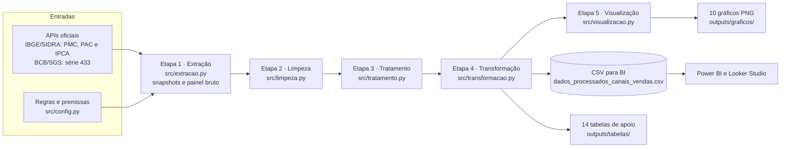

| Etapa | Módulo | O que faz | Controles principais |
|---|---|---|---|
| 1. Extração | [`src/extracao.py`](src/extracao.py) | consulta as APIs do IBGE (PMC 8880 e 8882, PAC 9349 e 10656, IPCA 1737) e do Banco Central (SGS 433), grava snapshots datados e simula o painel de canais, exportado como arquivo bruto com problemas de qualidade | até três tentativas por requisição, validação de formato, código SHA-256, uso do snapshot anterior em caso de falha, sementes fixas |
| 2. Limpeza | [`src/limpeza.py`](src/limpeza.py) | converte os sinais convencionais do IBGE, aplica soma estrita na PAC, padroniza rótulos, datas e números, remove duplicatas e imputa ausentes por razão | conferência com o gabarito da injeção de problemas, relatório de qualidade antes e depois |
| 3. Tratamento | [`src/tratamento.py`](src/tratamento.py) | cria fases e recortes, integra PMC e IPCA, deflaciona valores e calcula medidas derivadas e KPIs | faixas de sanidade linha a linha, tetos legais do MEI e da ME, identidades de clientes |
| 4. Transformação | [`src/transformacao.py`](src/transformacao.py) | agrega por razão de somas, calcula custo-volume-lucro, monta as 14 tabelas de apoio e exporta o CSV final | grão único e completo, ausência de nulos, tipos conferidos após a gravação |
| 5. Visualização | [`src/visualizacao.py`](src/visualizacao.py) | produz os 10 gráficos PNG com rodapé de fonte | cores fixas por canal, médias móveis por razão de somas |
| Orquestração | [`main.py`](main.py) | executa as etapas na ordem, configura o log e devolve o código de saída | erros de extração e de qualidade interrompem a execução com mensagem clara |
| Configuração | [`src/config.py`](src/config.py) | centraliza caminhos, endpoints, períodos, parâmetros da simulação e a origem de cada premissa | nenhum número fixo espalhado pelos módulos |

## Estrutura do repositório

```text
projeto-final-canais-de-venda/
├── README.md
├── index.html                    # página do projeto (GitHub Pages)
├── main.py                       # orquestrador do pipeline (linha de comando)
├── requirements.txt              # dependências com versões fixas
├── .gitignore
├── assets/
│   ├── css/style.css             # estilos da página
│   └── js/main.js                # interações da página
├── src/
│   ├── __init__.py               # pacote e exceções do pipeline
│   ├── config.py                 # caminhos, fontes, períodos, parâmetros e premissas
│   ├── extracao.py               # APIs oficiais, snapshots e simulação do painel bruto
│   ├── limpeza.py                # limpeza dos dados reais e do painel + relatório de qualidade
│   ├── tratamento.py             # fases, deflação, medidas derivadas e KPIs validados
│   ├── transformacao.py          # agregações por razão de somas, tabelas e CSV final
│   └── visualizacao.py           # 10 gráficos PNG
├── tests/
│   └── test_unidades.py          # 14 testes unitários (unittest, offline)
├── data/
│   ├── raw/
│   │   ├── api/                  # snapshots JSON datados + .meta.json (endpoint, data/hora, SHA-256)
│   │   └── simulado/             # canais_vendas_bruto.csv + .meta.json (sementes e gabarito)
│   └── processed/
│       └── dados_processados_canais_vendas.csv   # CSV final para BI
├── outputs/
│   ├── graficos/                 # 10 gráficos PNG
│   ├── tabelas/                  # 14 tabelas de apoio (CSV)
│   └── relatorio_qualidade_dados.json
└── docs/
    ├── ARTIGO_TECNICO.md         # artigo técnico em Markdown
    ├── artigo_tecnico.pdf        # artigo técnico em PDF
    ├── artigo_tecnico_narracao.mp3                        # narração do artigo em português
    └── Brazilian Small Business Sales Channels ... .mp3   # narração do artigo em inglês
```

## Fontes de dados

| Fonte | Conteúdo usado | Natureza | Período |
|---|---|---|---|
| [IBGE – PMC, tabela 8880](https://sidra.ibge.gov.br/tabela/8880) | índice de volume de vendas do varejo com ajuste sazonal (2022 = 100) | oficial: contexto e calibração | dez/2017 a ago/2026 (dez/2017 só como mês de aquecimento interno) |
| [IBGE – PMC, tabela 8882](https://sidra.ibge.gov.br/tabela/8882) | índices de volume e de receita nominal de cinco atividades, sem ajuste sazonal | oficial: direcionador do painel | dez/2017 a ago/2026 |
| IBGE – PAC, tabelas [9349](https://sidra.ibge.gov.br/tabela/9349) e [10656](https://sidra.ibge.gov.br/tabela/10656) | receita de revenda e número de empresas por forma de comercialização, com destaque para a Internet | oficial: contexto e calibração | 2019 a 2023 (9349) e 2024 (10656, série nova) |
| [IBGE – PAC, tabela 10645](https://sidra.ibge.gov.br/tabela/10645) | relação entre custo das mercadorias vendidas (CMV) e receita por atividade | oficial: parâmetro fixo do modelo | 2024 |
| [IBGE – IPCA, tabela 1737](https://sidra.ibge.gov.br/tabela/1737) | variação mensal do IPCA | oficial: deflator usado na execução | jan/2018 a set/2026 (análise até ago/2026) |
| BCB – SGS, série 433 | variação mensal do IPCA | oficial: fonte primária configurada, indisponível na extração | não se aplica |
| [Lei Complementar nº 123/2006](https://www.planalto.gov.br/ccivil_03/leis/lcp/lcp123.htm), Lei nº 8.212/1991 e Ipeadata | tetos do MEI (R$ 81.000) e da ME (R$ 360.000), DAS do MEI, Anexo I do Simples Nacional e salário mínimo | regra oficial | 2018 a 2026 |
| [Mercado Livre](https://www.mercadolivre.com.br/ajuda/quanto-custa-vender-um-produto_1338), [Shopee](https://seller.shopee.com.br/edu/article/18483/como-funciona-a-politica-de-comissao-para-vendedores-shopee), [Amazon](https://venda.amazon.com.br/precos) e [Nuvemshop](https://www.nuvemshop.com.br/planos-e-precos) | comissões, tarifas fixas, planos e processamento de pagamento | regra de mercado (páginas oficiais) | Mercado Livre de 2018 a 2024, por cópias arquivadas da página oficial; demais em out/2026 |
| Painel simulado do projeto | 3.120 linhas no grão mês × canal × porte × segmento | simulado e calibrado | jan/2018 a ago/2026 |

**Snapshots.** Cada resposta das APIs é gravada em `data/raw/api/` com data, hora, endpoint e código SHA-256 (consultas de 18/10/2026, entre 20h36 e 20h37). Assim, a análise pode ser repetida sem rede e é possível conferir que os arquivos não mudaram.

**Fallback do IPCA (BCB → IBGE).** A fonte primária configurada é a série 433 do SGS do Banco Central. Na extração de 18/10/2026, ela respondeu com uma página de erro em vez de JSON, e o pipeline usou automaticamente a tabela 1737 do SIDRA, do próprio IBGE, que produz o IPCA. A regra completa: com as duas fontes disponíveis e iguais (diferença de até 0,005 ponto percentual), usa-se a série do Banco Central, conferida com a do IBGE; se divergirem, prevalece a tabela 1737; se só uma estiver disponível, usa-se essa. A fonte efetiva fica registrada na coluna `fonte_ipca` do CSV (`IBGE SIDRA 1737` nesta execução), no relatório de qualidade e no rodapé dos gráficos.

**Painel simulado e calibrado.** Como não existe série pública mensal de receita, custos e clientes por canal para MEIs e MEs, o projeto simula 2.500 negócios sintéticos, cada um com um canal principal, de jan/2018 a ago/2026. A simulação é determinística (semente 2026 para o painel e 2027 para os problemas de qualidade) e usa como direcionadores a sazonalidade e os choques reais da PMC por atividade, com a tendência de longo prazo das grandes redes removida, os preços implícitos da PMC, o IPCA, as tarifas históricas do Mercado Livre, o processamento de pagamento da Nuvemshop, o CMV da PAC 2024, o DAS do MEI e o Anexo I do Simples para a ME. A receita anual por negócio nunca passa dos tetos legais (R$ 81.000 no MEI e R$ 360.000 na ME); uma violação interromperia o pipeline. Os 45 parâmetros têm a origem registrada em [`premissas.csv`](outputs/tabelas/premissas.csv): 7 de fonte oficial, 4 de fonte de mercado, 3 de fonte com ajuste do autor e 31 premissas do autor.

Seis checagens confrontam o painel com referências externas, e todas ficaram dentro das faixas aceitas ([`calibracao.csv`](outputs/tabelas/calibracao.csv)):

| Código | Checagem | Valor no painel | Faixa aceita | Referência | Situação |
|---|---|---|---|---|---|
| C1 | Multiplicador da receita digital nominal, 2019 → 2024 | 3,64 | de 3,21 a 13,4 | PAC, empresas com 20 ou mais pessoas ocupadas (3,21); MDIC, micro e pequenas empresas (13,4) | OK |
| C2 | Participação digital de 2021 ÷ a de 2019 | 2,84 | de 1,87 a 4,0 | PAC (9,84 ÷ 5,26) | OK |
| C3 | Receita real da Loja Física, abr/2020 em relação a fev/2020 | −38,71% | igual ou inferior a −15% | PMC 8880: −19,67% | OK |
| C4 | Receita real digital, abr/2020 em relação a fev/2020 | +87,10% | acima de 0% | migração para o digital (Sebrae, 2021) | OK |
| C5 | Participação digital no Cenário Atual | 33,31% | de 25% a 45% | Sebrae (2021) | OK |
| C6 | Take rate do Marketplace no Cenário Atual | 14,22% | de 10% a 19% | faixas Clássico e Premium do Mercado Livre | OK |

> As medidas por canal são simuladas e calibradas; não representam empresas reais. Passar nas checagens mostra que o painel não contradiz as referências disponíveis, e não que ele reproduz um negócio específico.

## Instalação

Requisitos: **Python 3.11 ou superior**, exigência do pandas 3.0.0 e do NumPy 2.4.2 fixados no [`requirements.txt`](requirements.txt). O projeto foi desenvolvido e testado com Python 3.13.2. A internet só é necessária para instalar as dependências e para rodar com `--atualizar`.

```bash
git clone https://github.com/KevynFirst/projeto-final-canais-de-venda.git
cd projeto-final-canais-de-venda
python -m venv .venv
```

Ative o ambiente virtual:

```powershell
# Windows (PowerShell)
.venv\Scripts\Activate.ps1
```

```bash
# Linux ou macOS
source .venv/bin/activate
```

Instale as dependências (pandas 3.0.0, numpy 2.4.2, matplotlib 3.10.9, seaborn 0.13.2 e requests 2.34.2):

```bash
pip install -r requirements.txt
```

## Execução

Todos os comandos são executados na raiz do repositório.

```bash
# Modo padrão (offline): usa os snapshots versionados em data/raw/api/
python main.py

# Baixa de novo as fontes oficiais e grava novos snapshots datados
python main.py --atualizar

# Log detalhado (níveis aceitos: DEBUG, INFO, WARNING, ERROR)
python main.py --nivel-log DEBUG
```

- **`python main.py`** roda offline em cerca de 10 a 15 segundos e regenera o arquivo bruto simulado, o relatório de qualidade, o CSV final, as 14 tabelas e os 10 gráficos. O log da execução fica em `outputs/logs/pipeline.log`, gerado localmente e fora do controle de versão. O código de saída é 0 em caso de sucesso e 1 em erro tratado, como snapshot ausente ou violação de qualidade.
- **`python main.py --atualizar`** consulta de novo as seis fontes oficiais. Se uma fonte falhar, o pipeline usa o snapshot anterior válido; para o IPCA, aplica o fallback BCB → IBGE descrito em [Fontes de dados](#fontes-de-dados). O último mês da série é o menor entre o último mês da PMC 8880, da PMC 8882, do IPCA e o mês anterior ao da execução. Com novas divulgações do IBGE, a série se estende sem mudar o código, e os números deste README, calculados com os snapshots de 18/10/2026, podem mudar.

**Testes unitários** (14 testes, offline, em menos de 1 segundo):

```bash
python -m unittest discover -s tests -v
```

Os testes cobrem a leitura de rótulos, datas e números em formato brasileiro, a razão de somas e a identidade do ponto de equilíbrio, as alíquotas do Simples Nacional, os recortes temporais, as tarifas do Mercado Livre e as regras de 2026, o registro de premissas, a imputação por razão, a soma estrita da PAC sob sigilo e a injeção reproduzível de ausentes.

## Saídas do pipeline

### CSV para BI

[`data/processed/dados_processados_canais_vendas.csv`](data/processed/dados_processados_canais_vendas.csv): 3.120 linhas × 59 colunas (104 meses × 3 canais × 2 portes × 5 segmentos), em formato longo, com chave `data, canal, porte, segmento`. Usa UTF-8, vírgula como separador, ponto decimal e datas ISO (`AAAA-MM-01`), sem nulos, pronto para importar no Power BI e no Looker Studio. Os valores monetários estão em reais correntes, e as colunas com sufixo `_real` estão em reais de ago/2026, deflacionados pelo IPCA.

| Colunas | Grupo | Exemplos | Natureza |
|---|---|---|---|
| 1–10 | tempo e recortes | `data`, `ano_mes`, `fase`, `recorte_temporal`, `flag_cenario_atual` | calendário e marcos oficiais |
| 11–16 | dimensões | `canal`, `porte`, `segmento`, `atividade_pmc_referencia` | modelo |
| 17–35 | medidas aditivas | `negocios_ativos`, `receita_bruta`, `receita_bruta_real`, `pedidos`, `clientes_novos`, `cmv`, `custos_fixos`, `margem_liquida` | painel simulado e calibrado |
| 36–51 | KPIs da linha | `ticket_medio`, `cac`, `take_rate`, `margem_liquida_pct`, `taxa_retencao`, `ltv`, `ltv_cac`, `ponto_equilibrio_receita` | derivados do painel |
| 52–57 | indicadores do mês | `pmc_indice_volume_varejo_sa`, `pmc_indice_volume_segmento`, `ipca_variacao_mensal`, `deflator_ipca` | dados oficiais (IBGE) |
| 58–59 | linhagem e qualidade | `fonte_ipca`, `qtd_campos_imputados` | metadados |

Ao agregar, some as medidas aditivas e recalcule os KPIs como razão de somas (por exemplo, ticket médio = soma de `receita_bruta` ÷ soma de `pedidos`). A média de uma coluna de KPI distorce o resultado.

### Tabelas de apoio

As 14 tabelas de `outputs/tabelas/` sustentam os números do artigo, deste README e da página do projeto.

| Arquivo | Conteúdo |
|---|---|
| [`kpis_recorte_canal.csv`](outputs/tabelas/kpis_recorte_canal.csv) | medidas, KPIs e participação por recorte temporal × canal (12 linhas) |
| [`kpis_recorte_canal_porte.csv`](outputs/tabelas/kpis_recorte_canal_porte.csv) | o mesmo por recorte × canal × porte (24 linhas) |
| [`kpis_atual_canal_porte_segmento.csv`](outputs/tabelas/kpis_atual_canal_porte_segmento.csv) | Cenário Atual por canal × porte × segmento (30 linhas) |
| [`serie_mensal_canal.csv`](outputs/tabelas/serie_mensal_canal.csv) | série mensal por canal, somando portes e segmentos (312 linhas) |
| [`composicao_custos_atual.csv`](outputs/tabelas/composicao_custos_atual.csv) | composição da receita em custos e margem por porte × canal, Cenário Atual |
| [`cvp_parametros_atual.csv`](outputs/tabelas/cvp_parametros_atual.csv) | custo variável (v), custo fixo (F), ponto de equilíbrio e receita de referência por porte, segmento e canal |
| [`receita_indiferenca_canais.csv`](outputs/tabelas/receita_indiferenca_canais.csv) | receitas de indiferença entre pares de canais e o canal vencedor abaixo e acima de cada uma |
| [`matriz_recomendacao.csv`](outputs/tabelas/matriz_recomendacao.csv) | recomendação de canal por porte × segmento (10 linhas) |
| [`tarifas_marketplaces_2026.csv`](outputs/tabelas/tarifas_marketplaces_2026.csv) | take rate efetivo por valor do item nas regras de 2026 do Mercado Livre, da Shopee e da Amazon |
| [`calibracao.csv`](outputs/tabelas/calibracao.csv) | checagens de calibração C1 a C6 |
| [`indicadores_reais.csv`](outputs/tabelas/indicadores_reais.csv) | indicadores oficiais selecionados da PMC, do IPCA e da PAC |
| [`premissas.csv`](outputs/tabelas/premissas.csv) | registro dos 45 parâmetros com valor, origem, referência e justificativa |
| [`serie_macro_mensal.csv`](outputs/tabelas/serie_macro_mensal.csv) | PMC e IPCA mensais, somente dados oficiais (104 meses) |
| [`pac_internet.csv`](outputs/tabelas/pac_internet.csv) | participação da Internet na PAC por ano e grupo, com marcação de sigilo estatístico (42 linhas) |

### Qualidade e dados brutos

- [`outputs/relatorio_qualidade_dados.json`](outputs/relatorio_qualidade_dados.json): situação antes e depois da limpeza. O arquivo bruto tinha 3.183 linhas e terminou com 3.120; saíram 47 duplicatas exatas e 16 duplicatas por chave, 1.092 células ausentes foram imputadas por razão, e a conferência com o gabarito foi aprovada. O relatório também conta os sinais convencionais do IBGE ("X" = sigilo, "-" = zero absoluto).
- [`data/raw/simulado/canais_vendas_bruto.csv`](data/raw/simulado/canais_vendas_bruto.csv): painel exportado como extração de um sistema de gestão, com problemas injetados de forma controlada (datas em três formatos, números em padrão brasileiro, rótulos variantes, duplicatas e células vazias). O [`.meta.json`](data/raw/simulado/canais_vendas_bruto.meta.json) guarda as sementes, os snapshots usados e o gabarito da injeção.
- `data/raw/api/`: snapshots das APIs oficiais com os respectivos `.meta.json`.

## Gráficos

Os 10 gráficos são gerados por [`src/visualizacao.py`](src/visualizacao.py) e ficam em `outputs/graficos/`.

**01 – Receita real por canal (painel simulado).** Receita mensal em reais de ago/2026, com média móvel de 3 meses e fases sombreadas. Entre fev e abr/2020, a receita real da Loja Física cai 38,71% e a dos canais digitais sobe 87,10%, e o digital não devolve o espaço conquistado.

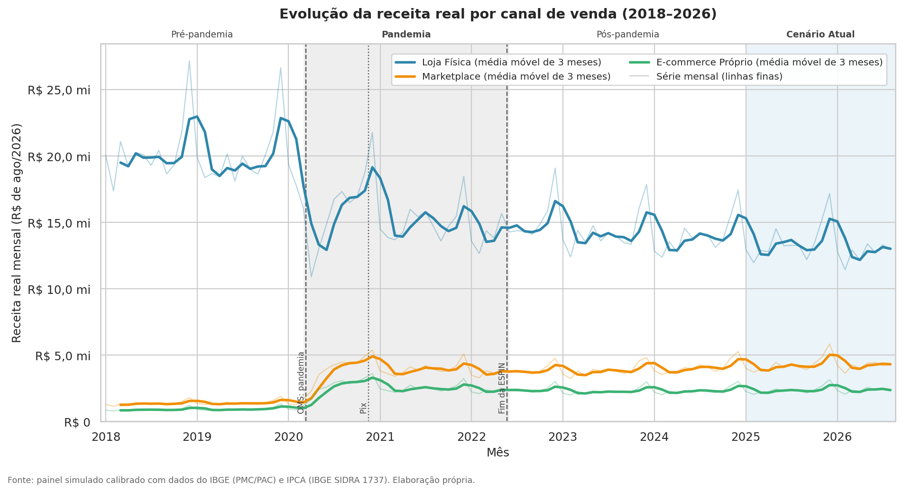

**02 – Participação dos canais por fase (painel simulado).** A Loja Física passa de 89,69% da receita real na Pré-pandemia para 66,69% no Cenário Atual; o Marketplace vai de 6,18% para 21,40%, e o E-commerce Próprio, de 4,13% para 11,91%.

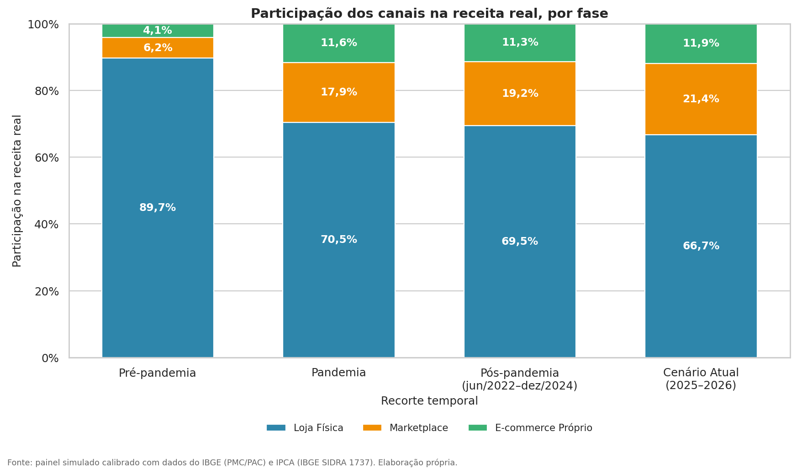

**03 – Composição de custos e margem por canal (painel simulado, Cenário Atual).** Cada canal gasta a receita em um lugar diferente: custo fixo na Loja Física (24,50% da receita no MEI), comissão no Marketplace (14,19%) e marketing mais frete no E-commerce Próprio (11,16% e 8,36%). Margem líquida realizada do MEI: 9,13% na Loja Física, 5,65% no canal próprio e 3,44% no Marketplace.

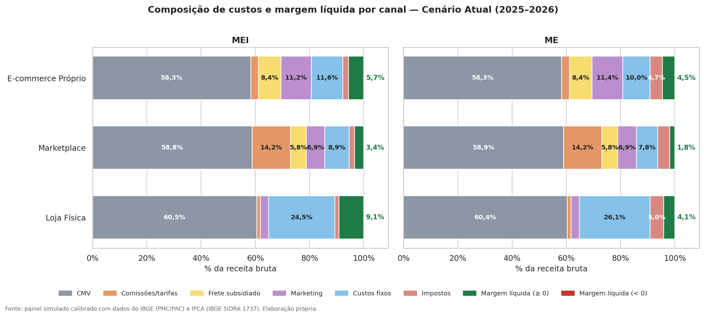

**04 – CAC × LTV (painel simulado, Cenário Atual).** As 30 combinações de canal, porte e segmento em escala logarítmica, com as retas LTV = CAC e LTV = 3 × CAC. As 10 combinações da Loja Física ficam acima de 3× (LTV/CAC de 7,40 a 24,41), em parte por efeito contábil, e 16 das 30 combinações atingem LTV/CAC de pelo menos 3.

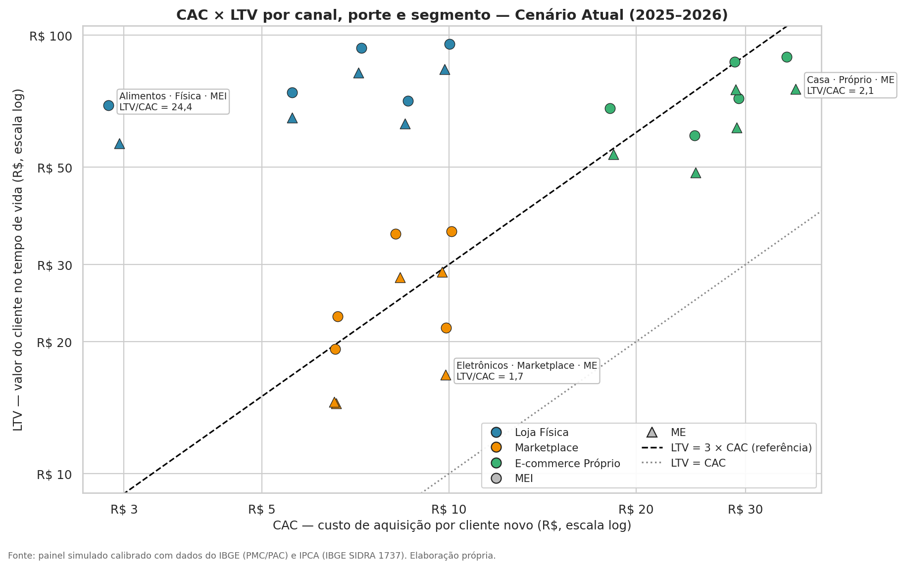

**05 – Ticket médio real por canal e fase (painel simulado).** O E-commerce Próprio tem o maior ticket em todos os recortes: R$ 153,95 no Cenário Atual, contra R$ 113,85 no Marketplace e R$ 106,35 na Loja Física, em reais de ago/2026.

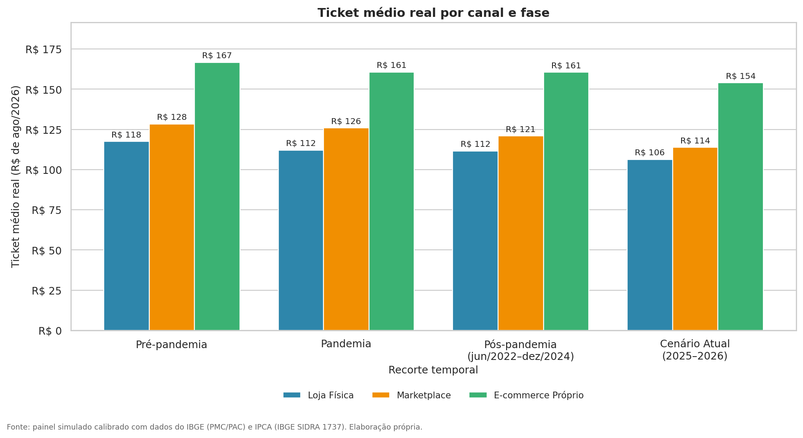

**06 – Taxa de retenção no tempo (painel simulado).** Média móvel de 3 meses calculada por razão de somas. A retenção do E-commerce Próprio sobe de 22,93% na Pré-pandemia para 30,66% no Cenário Atual (premissa de amadurecimento do relacionamento direto); a do Marketplace fica entre 9,42% e 9,72% nos recortes, e a da Loja Física, entre 34,56% e 35,67%.

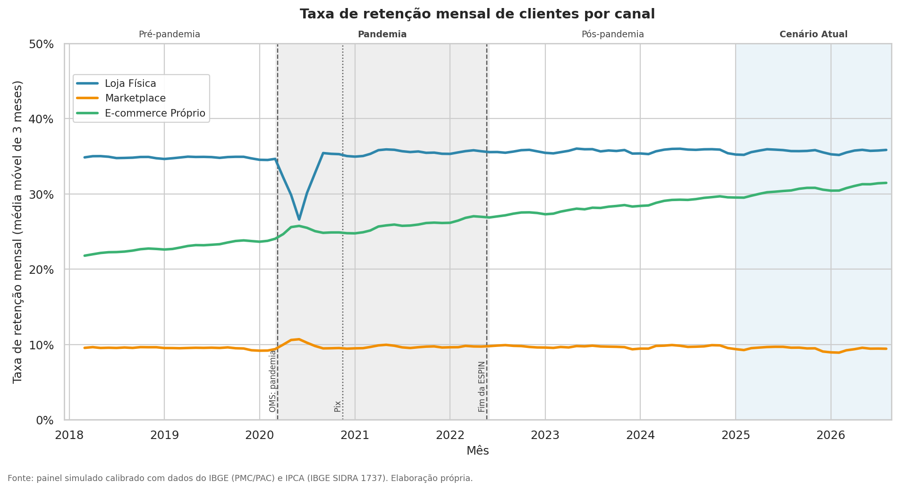

**07 – Take rate do marketplace × custos do e-commerce próprio.** (a) Painel simulado: take rate do Marketplace (14,22% no Cenário Atual) contra o marketing e as tarifas do E-commerce Próprio, em percentual da receita. (b) Regras oficiais de out/2026 aplicadas a um item isolado: um item de R$ 30 paga 32,00% no Mercado Livre Clássico, 35,00% na Shopee CNPJ e 19,17% na Amazon Individual, e na Shopee o custo salta de 25,63% em R$ 79,99 para 34,00% em R$ 80.

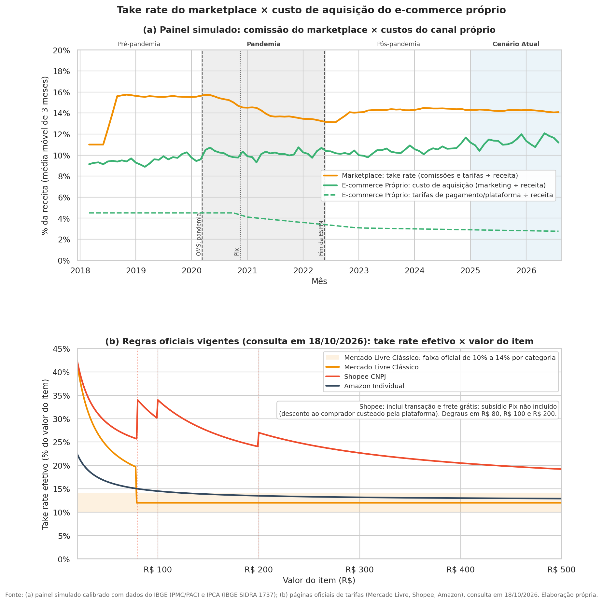

**08 – Mapa de calor da margem líquida (painel simulado).** Margem líquida por canal e porte na Pré-pandemia e no Cenário Atual, por razão de somas. Todas as margens caem, e a maior queda é a do Marketplace da ME, de 5,35% para 1,85%.

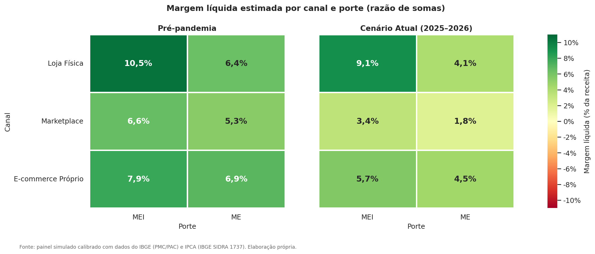

**09 – Contexto macroeconômico real (somente dados oficiais do IBGE).** (a) Volume do varejo com ajuste sazonal (PMC 8880, 2022 = 100): 98,13 em fev/2020, 78,83 em abr/2020 e 108,69 em ago/2026. (b) IPCA mensal e acumulado em 12 meses, com pico de 12,13% em abr/2022. (c) Participação da Internet na receita do varejo com 20 ou mais pessoas ocupadas (PAC): 5,26% em 2019 e 9,78% em 2024 (série nova), com os segmentos só nos anos sem sigilo estatístico.

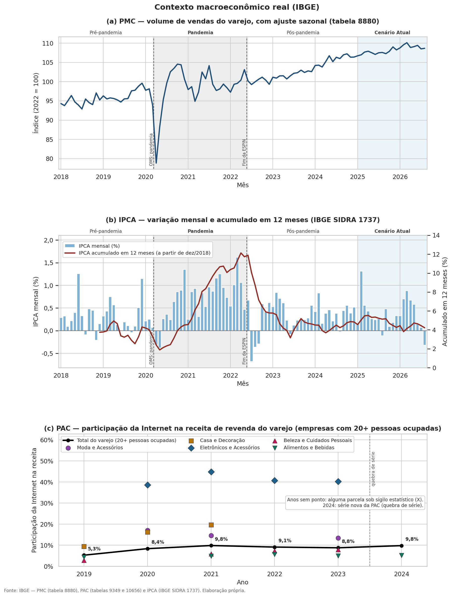

**10 – Ponto de equilíbrio por canal (painel simulado, Cenário Atual).** Diagrama custo-volume-lucro com uma reta de margem por canal, margem = R × (1 − v) − F. No MEI, o ponto de equilíbrio é de R$ 3.811,80 na Loja Física, R$ 2.986,93 no Marketplace e R$ 2.634,34 no E-commerce Próprio; os cruzamentos entre as retas são as receitas de indiferença que definem as faixas de decisão.

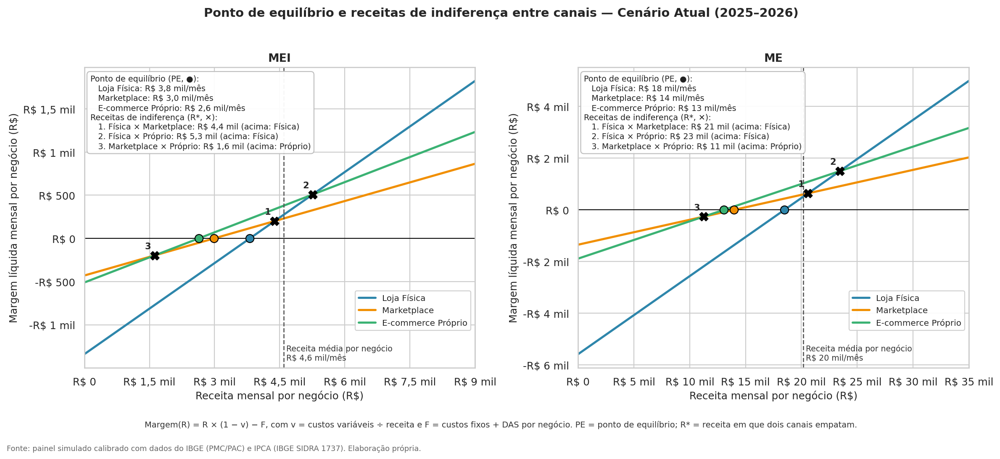

## Metodologia e fórmulas dos KPIs

Todos os indicadores são calculados por **razão de somas**: primeiro somam-se as medidas aditivas no nível de agregação desejado (Σ) e só depois se divide. A média simples de razões daria o mesmo peso a combinações de tamanhos muito diferentes. Uma única função, `kpis_de_componentes` em [`src/tratamento.py`](src/tratamento.py), calcula os KPIs de cada linha e de qualquer agregado, o que impede fórmulas divergentes.

| Indicador | Fórmula |
|---|---|
| Ticket médio | Σ `receita_bruta` ÷ Σ `pedidos` |
| Frequência de compra | Σ `pedidos` ÷ Σ `clientes_ativos` |
| CAC | Σ `investimento_marketing` ÷ Σ `clientes_novos` |
| Take rate (taxa de intermediação) | Σ `comissoes_tarifas` ÷ Σ `receita_bruta` |
| Margem de contribuição | `receita_bruta` − `cmv` − `comissoes_tarifas` − `frete_subsidiado` − `impostos_variaveis` |
| Margem de contribuição % | Σ `margem_contribuicao` ÷ Σ `receita_bruta` |
| Margem líquida estimada | `margem_contribuicao` − `investimento_marketing` − `custos_fixos` − `impostos_fixos` |
| Margem líquida % | Σ `margem_liquida` ÷ Σ `receita_bruta` |
| Taxa de retenção mensal (r) | Σ `clientes_recorrentes` ÷ Σ `clientes_ativos_mes_anterior` |
| Tempo de vida (meses) | 1 ÷ (1 − r) |
| LTV | (Σ `receita_bruta` ÷ Σ `clientes_ativos`) × margem de contribuição % × 1 ÷ (1 − r) |
| LTV/CAC | LTV ÷ CAC (referência visual: 3) |
| Payback do CAC (meses) | CAC ÷ (Σ `margem_contribuicao` ÷ Σ `clientes_ativos`) |
| Receita por negócio | Σ `receita_bruta` ÷ Σ `negocios_ativos` |
| Custo variável (v) | (Σ `cmv` + Σ `comissoes_tarifas` + Σ `frete_subsidiado` + Σ `impostos_variaveis` + Σ `investimento_marketing`) ÷ Σ `receita_bruta` |
| Custo fixo por negócio (F) | (Σ `custos_fixos` + Σ `impostos_fixos`) ÷ Σ `negocios_ativos` |
| Ponto de equilíbrio (PE) | F ÷ (1 − v) |
| Folga sobre o PE | receita por negócio ÷ PE − 1 |
| Receita de indiferença (R\*) entre os canais A e B | (F de A − F de B) ÷ (v de B − v de A) |
| Participação do canal | Σ `receita_bruta_real` do canal ÷ Σ `receita_bruta_real` de todos os canais |

**Custo-volume-lucro.** A margem mensal de um canal vale R × (1 − v) − F, em que R é a receita mensal por negócio. Abaixo da receita de indiferença R\*, vence o canal de menor custo fixo; acima, o de menor custo variável. Como o marketplace troca custo fixo por variável e a loja física faz o inverso, a escala de faturamento decide qual estrutura compensa. Por construção, a margem líquida por negócio é igual a (receita por negócio − PE) × (1 − v), identidade conferida em teste automatizado.

**Tributos.** O MEI paga o DAS fixo do mês (5% do salário mínimo + R$ 1,00 de ICMS), que entra em F. A ME recolhe o Simples Nacional pelo Anexo I, com alíquota efetiva = (RBT12 × alíquota nominal − parcela a deduzir) ÷ RBT12, que entra em v.

**Qualidade dos dados.** O painel bruto chega com datas em três formatos (AAAA-MM, MM/AAAA e AAAA-MM-01), números em padrão brasileiro com e sem o símbolo da moeda, rótulos variantes como "MKT", "Mkt place" e "loja fisica", duplicatas e células vazias. As células ausentes são reconstruídas com valores da própria linha e razões estáveis dos meses vizinhos (por exemplo, receita = CMV ÷ relação CMV/receita), com a regra legal do DAS e com identidades exatas (clientes ativos = novos + recorrentes), o que preserva o pico de dezembro e o choque de abril de 2020. Nos dados oficiais, a soma da PAC é estrita: qualquer parcela sob sigilo torna o resultado indisponível, nunca zero nem soma parcial.

## Limitações e próximos passos

**Limitações**

- **Painel simulado:** as medidas por canal são simuladas e calibradas, não representam empresas reais, e as conclusões valem sob as premissas declaradas em `premissas.csv`.
- **Cobertura oficial:** PMC e PAC cobrem empresas com 20 ou mais pessoas ocupadas; a PAC de 2024 é série nova, com quebra de comparabilidade; e o sigilo estatístico só deixa 2021 completo nos cinco segmentos.
- **Um canal principal por negócio:** a recomendação "híbrida" indica empate técnico entre dois canais, e não uma operação multicanal modelada.
- **Premissas de custo e cliente:** custos fixos, CAC, frete e retenção são premissas do autor, e o CAC da Loja Física é baixo por construção, porque o tráfego de passagem é pago pelo aluguel.
- **Tarifas:** a série histórica usa o Mercado Livre como referência, com o custo fixo posterior a jan/2024 mantido como premissa, e o histórico da Shopee anterior a 2026 não pôde ser verificado.
- **Medida:** a imputação tem erro pequeno, mas não nulo (a coluna `qtd_campos_imputados` marca as 1.092 linhas afetadas); o LTV não desconta fluxos futuros; e 2026 está incompleto (jan–ago), o que exige comparar anos por participações ou médias mensais.
- **Análise estática:** o custo-volume-lucro supõe que o negócio alcançaria a mesma receita em qualquer canal, então não captura o acesso imediato a compradores que favorece o marketplace na entrada.
- **IPCA:** a série 433 do Banco Central estava indisponível na extração; o deflator usado é a tabela 1737 do IBGE.

**Próximos passos**

- Substituir o painel por dados reais de vendas de MEIs e MEs, obtidos com consentimento junto a plataformas de gestão ou parceiros.
- Medir CAC e retenção efetivos com testes controlados entre canais.
- Modelar negócios com vários canais simultâneos e rateio de custos fixos.
- Incluir desconto financeiro no LTV e análise de sensibilidade sistemática das premissas.
- Incorporar a contagem oficial de MEIs e os dados abertos do Pix quando houver acesso estável.

## Autoria e contato

Kevyn Bezerra Ladislau – GitHub: https://github.com/KevynFirst
